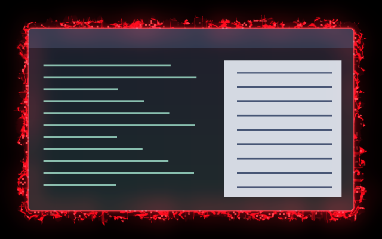

# Blackwall

A hostile data barrier around the focused window: a near-black wall of writhing tissue pushes outward from the edge, threaded with hot veins and lashing tendrils, with data blocks drifting outward, a searing edge line, a slow breathing pulse and occasional glitch tears with colour-split static.



Frame rendered by Umbriel running this shader over a synthetic window sample in its manual colours (`palette = false`); it is not a screenshot of a desktop session. The wall's black body is most visible over a lighter wallpaper.

## Use

Download [effect.toml](effect.toml) and [shader.glsl](shader.glsl) and save them together in `~/.config/umbriel/shaders/community/border/blackwall/`. See [installation](../../README.md#install) for details.

Then merge this into `~/.config/umbriel/config.toml`:

```toml
[include]
files = ["shaders/community/border/blackwall/effect.toml"]

[effects]
border = "blackwall"
```

Append the include path to your existing `files` array and merge selectors into existing tables. [`config.toml`](config.toml) contains the same copyable example.

Borders apply to the focused, decorated window. Fullscreen and urgent windows do not display the border effect.

## Theme palette

This preset enables `palette = true` in `effect.toml`, so the wall follows Umbriel's `[colors]`, which Noctalia can keep in sync with its colour scheme:

- `accent_primary` colours the veins, tendrils and edge line. The near-black body, the dark glow and the pale highlights are derived from it.
- `accent_secondary` colours the drifting data blocks and the static in glitch tears.

Set `palette = false` to use the manual colours instead. They are the `COL_*` constants at the top of [shader.glsl](shader.glsl), shipped as black and crimson (shown in the preview). To recolour by hand, edit those constants. For example, a dusky lavender:

```glsl
const vec3 COL_BLACK = vec3(0.012, 0.006, 0.022);
const vec3 COL_DEEP = vec3(0.17, 0.08, 0.30);
const vec3 COL_MAIN = vec3(0.66, 0.52, 0.92);
const vec3 COL_HOT = vec3(0.93, 0.86, 1.0);
const vec3 COL_DATA = vec3(0.80, 0.70, 0.98);
```

Values are straight RGB from 0 to 1; divide each hex pair by 255 (`#A985EB` is `0.66, 0.52, 0.92`).

## Configuration options

Edit the existing `[effects.preset.blackwall]` table in [effect.toml](effect.toml).

| TOML setting | Shipped value | What changing it does |
| --- | --- | --- |
| `kind` | `"border"` | Keep this kind: the source implements its `border` entry point. |
| `shader` | `"shader.glsl"` | Loads the source beside this preset. |
| `palette` | `true` | Follows the theme accents. Set false to use the manual `COL_*` colours in the shader. |
| `padding` | `28` | Logical pixels of outward drawing space. Keep it above `WALL_MAX + TENDRIL_REACH` or the wall's front is clipped. |
| `speed` | `1.0` | Time multiplier: 0.5 halves speed, 2 doubles it, 0 freezes at time zero. |
| `animated` | `true` | Set false to freeze this border at time zero. |

The `[effects.preset.blackwall.light]` subtable casts light in the wall's colour onto surroundings. Remove the whole table to disable it.

| Light setting | Shipped value | What changing it does |
| --- | --- | --- |
| `spread` | `48` | Logical-pixel reach; larger spreads light farther. |
| `intensity` | `1.1` | Brightness; 0 makes the light invisible. |
| `threshold` | `0.35` | Raise to emit only from the brightest veins and edge. |

### Shader controls

Edit these constants at the top of [shader.glsl](shader.glsl).

| GLSL control | Shipped value | Visual effect |
| --- | --- | --- |
| `WALL_MIN`, `WALL_MAX` | `10.0`, `22.0` | Shortest and longest reach of the wall's ragged front, in logical px outside the window. |
| `TENDRIL_REACH` | `6.0` | How far tendrils lash past the front, in logical px. |
| `WRITHE_SPEED` | `0.35` | How fast the wall churns. |
| `CRAWL_SPEED` | `14.0` | Logical px per second the features drift around the window. |
| `VEIN_WIDTH`, `VEIN_GAIN` | `0.09`, `1.4` | Thickness and brightness of the veins. |
| `DATA_CELL`, `DATA_DENSITY`, `DATA_SPEED` | `3.0`, `0.16`, `18.0` | Size (px), share of cells lit, and outward speed (px/s) of the data blocks. `DATA_DENSITY = 0` removes them. |
| `GLITCH_PERIOD`, `GLITCH_CHANCE`, `GLITCH_PX` | `2.5`, `0.55`, `18.0` | Seconds between tear chances, odds of a tear, and sideways jump in px. `GLITCH_CHANCE = 0` removes tears. |
| `PULSE_PERIOD` | `3.2` | Seconds per breathing beat of the wall. |
| `COL_BLACK`, `COL_DEEP`, `COL_MAIN`, `COL_HOT`, `COL_DATA` | black, crimson, red, pink-white, light red | Manual colours, used only with `palette = false`. |
| `DEEP_SHARE`, `BLACK_SHARE`, `HOT_WHITE` | `0.28`, `0.015`, `0.65` | Theme mode: strength of the dark glow and body tint relative to `accent_primary`, and how far highlights blend toward white. |
| `DATA_ACCENT` | `0.7` | Theme mode: how much data blocks and glitch static use `accent_secondary` (0 to 1). |

Save and reload; see [reloading edits](../../README.md#reloading-edits).

## Compatibility and cost

Uses only the preset effects API and the theme palette; tested with Umbriel `1bbbf155d25b`. No previous-frame feedback buffers are used and the window is never sampled. The shader reads `umbriel_time`, so it keeps requesting frames while a window is focused. Each border fragment within reach of the edge evaluates four 4-octave noise sums and two single noise lookups, all in bounded loops. These are doubled within 60 logical pixels of the top-left corner, where the perimeter seam is blended. Compositor border light is added on top. No performance benchmark is claimed.

The preview does not verify HDR, rotated outputs, fractional scaling or motion quality.

## Attribution

Author/contributor: AngieAlter. License: [MIT](../../LICENSES/AngieAlter-MIT.txt).
